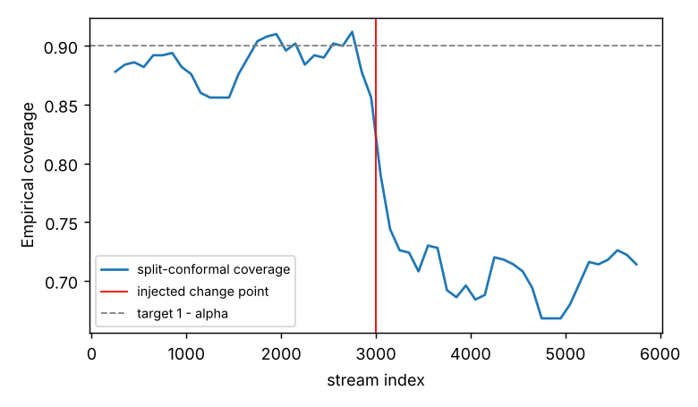
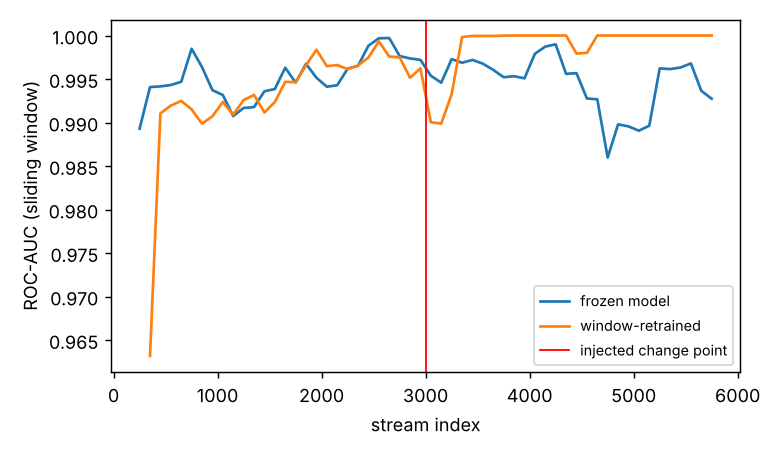
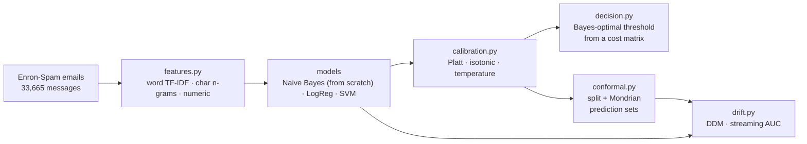
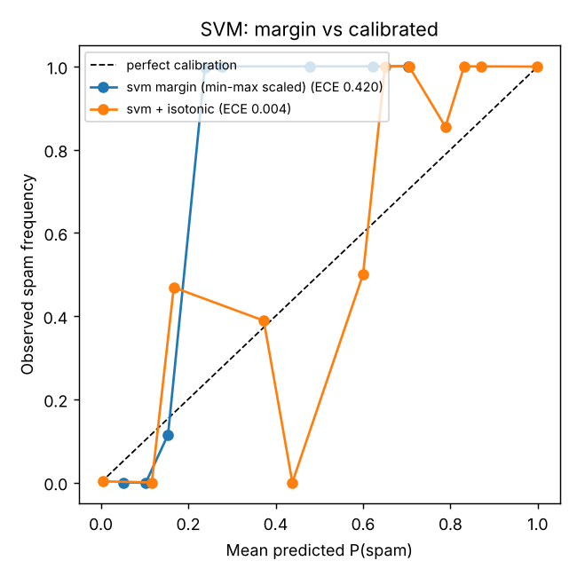
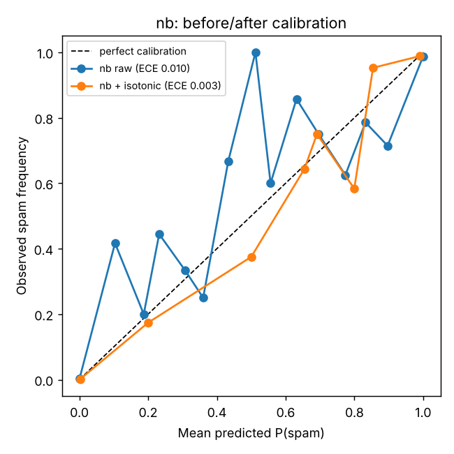

# SpamGuard

[](https://github.com/John-Ferd/NLP-Email-Spam-Classifier/actions/workflows/ci.yml) 

**A spam classifier is a solved problem. The interesting questions begin the moment the classifier has to make a consequential, asymmetric decision in an adversarial, non-stationary world.** SpamGuard is built around those questions: *how confident should we be, what should we do about it, what can we guarantee, and how do we know when the world has moved out from under us?*

The classification accuracy here is near-ceiling and is **not** the point. The project is about the four things that sit on top of a classifier and actually determine whether it is safe to deploy:

| Layer | Question it answers | Techniques |
|---|---|---|
| **Calibration** (Tier 1) | Do the predicted probabilities mean what they say? | Platt / isotonic / temperature scaling, ECE/MCE, reliability diagrams |
| **Cost-sensitive decisions** (Tier 1) | Given asymmetric costs, what threshold is optimal? | Bayes-optimal threshold from a cost matrix |
| **Conformal prediction** (Tier 2) | What can we *guarantee* about coverage, distribution-free? | Split + Mondrian conformal, finite-sample coverage |
| **Drift** (Tier 2) | How do we detect that the input distribution has shifted? | DDM from scratch, streaming AUC, conformal coverage as a canary |

Everything below is reproducible from the scripts in this repo on the public Enron-Spam corpus (`seed = 0`).

---

> **Project history:** first built in 2025. In November 2026 it was rebuilt into a tested, reproducible package and published here, so the commit history starts then. All numbers in this README come from this published version.

## TL;DR — headline results (real numbers, Enron-Spam, n ≈ 33,665)

- **Discrimination is table-stakes and we treat it that way.** Logistic Regression reaches ROC-AUC **0.9994**; even the from-scratch Naive Bayes reaches **0.996** with FPR **1.7%** at 99% recall. These numbers are reported and then set aside.
- **Probability quality is where models actually differ.** Raw Expected Calibration Error: Naive Bayes **0.010**, LogReg **0.036** (*under*confident: L2 regularization shrinks its logits toward 0), linear SVM **0.420** (its "scores" are margins, not probabilities). A single held-out calibration step drives the SVM to **0.004** — a ~117× improvement — *without changing its AUC at all.*
- **Calibrated probabilities enable optimal decisions.** Under a 10:1 cost asymmetry (deleting a real email is 10× worse than missing spam), the closed-form Bayes threshold **τ\* = 0.909** cuts expected cost by **39.1%** versus the naive 0.5 threshold.
- **Conformal prediction delivers its guarantee — on average, which is what it promises.** At a target of 90%, split-conformal coverage averaged over 30 random calibration draws is **91.6%** (≥ 90% ✓). Any *single* draw can land below: the seed-0 draw gives 89.3%. Marginal coverage also hides a gap between classes (spam 89.3% vs ham 93.9% on average), which class-conditional (Mondrian) conformal closes (spam 91.4%).
- **The drift result is the most important finding in the repo.** Under an injected concept-drift attack, **ROC-AUC barely moves (0.995 → 0.986) while conformal coverage collapses (0.886 → 0.668).** A team monitoring only discrimination would see nothing wrong. Calibration/coverage are *leading* indicators of drift; AUC is a *lagging* one.

<p align="center"> </p>

*Left: conformal coverage dives the instant the distribution shifts (red line = injected change point). Right: the same event is nearly invisible to AUC for both the frozen and the retrained model.*

---

## Why this project exists

A from-scratch TF-IDF + Naive Bayes spam classifier hitting 98.7% accuracy is a fine first exercise and a weak portfolio signal, because it demonstrates a problem that the field solved two decades ago and that no longer discriminates between candidates. Worse, headline accuracy actively *hides* the questions that matter in production:

- **Accuracy ignores asymmetry.** In spam, a false positive (a deleted job offer) and a false negative (one more pill ad) are not remotely equal. Accuracy weights them identically. The right object is *expected cost under a cost matrix*, and the right knob is the *decision threshold*, not the model.
- **A point prediction hides uncertainty.** "Spam, probability 0.91" is only actionable if 0.91 is a real long-run frequency. Most classifiers — including Naive Bayes and any margin-based model — emit numbers that look like probabilities but are not. **Calibration** is what makes the number mean something.
- **No model is honest about what it doesn't know.** A guarantee like "the true label is in my prediction set 90% of the time, whatever the data distribution" is far stronger than a single confidence score. That is **conformal prediction**, and it is distribution-free and finite-sample.
- **The world is non-stationary and adversarial.** Spammers actively mutate their messages to evade filters. A model frozen at training time silently rots. **Drift detection** is how you notice — and, as this repo shows, *what* you monitor matters enormously.

These are exactly the competencies that transfer to quantitative finance and ML research: decision-making under asymmetric loss, uncertainty quantification with guarantees, and monitoring a model whose edge decays as the environment adapts. SpamGuard is a spam classifier only on the surface; underneath it is a study of trustworthy probabilistic decision-making.

### What this project is deliberately *not*

- **Not an accuracy contest.** If you are looking for a 0.001 F1 improvement, this is the wrong repo.
- **Not an MLOps / serving project.** There is no FastAPI service or Docker image here *by design* (CI only runs lint, tests and a smoke run) — that engineering story lives in a separate project. SpamGuard is about statistical and decision-theoretic rigor.
- **Not an online-learning project.** Drift is *detected and quantified*, not *adapted to*. Regret-bounded online learners are named as the natural next step and left out of scope (see [Scope boundary](#the-scope-boundary-detection-not-adaptation)).

---

## The data, and a critical caveat that drives the whole design

The corpus is the consolidated [Enron-Spam](https://github.com/MWiechmann/enron_spam_data) dataset: **33,716 labelled messages** (subject + body), of which ~51 with empty subject *and* body are dropped, leaving **33,665**. The class balance is benign — **51% spam / 49% ham** — so we are not fighting class imbalance, which lets the harder questions (calibration, coverage, drift) take center stage.

Each message carries a real `Date`. It is tempting to sort chronologically and study "concept drift" on the natural timeline. **That would be a serious methodological error on this corpus**, and recognizing why is the single most important piece of data thinking in the project:

```
                 earliest        median          latest         n
   ham           1999-12-10     2001-03-01     2002-03-25     16,545
   spam          2001-05-25     2005-01-30     2005-09-06     17,171
```

| year | ham | spam |
|---|---|---|
| 2000 | 6,762 | 0 |
| 2001 | 8,375 | 45 |
| 2002 | 1,272 | 1,330 |
| 2004 | 0 | 6,097 |
| 2005 | 0 | 9,590 |

**The label and the date are almost perfectly confounded.** Nearly all ham predates nearly all spam. If you sort by date, the early stream is ~100% ham and the late stream is ~100% spam, so *date is a near-perfect proxy for the label*. Any model trained on a chronological split would "succeed" by learning the calendar, and any "drift" you measured would be this leakage, not genuine concept change. This is a textbook shortcut/leakage trap, and it dictates two non-negotiable design decisions:

1. **The main train/calibration/test split is stratified-random, not temporal.** A temporal split here leaks the label. (`data.make_splits`)
2. **The drift experiment uses *controlled injection* with a known ground-truth change point**, because the natural time axis cannot support an honest drift study. Controlled injection is, in fact, the only way to obtain meaningful detector metrics — detection delay and false-alarm rate are only definable against a known change point. (`data.make_drift_stream`)

If an interviewer asks "why didn't you just use the dates?", this is the answer, and it is a stronger answer than any chronological experiment would have been.

---

## Architecture



## Repository layout

```
├── README.md                      ← this document
├── Makefile · pyproject.toml      ← setup / data / test / run targets
├── configs/default.yaml           ← every hyperparameter (costs, alpha, drift params, ...)
├── src/spamguard/
│   ├── data.py                    ← loading, stratified splits, confound report, drift injection
│   ├── features.py                ← word TF-IDF · char n-grams · handcrafted numeric
│   ├── models/
│   │   ├── naive_bayes.py         ← from-scratch Multinomial NB (log-space)
│   │   └── registry.py            ← nb · logreg · svm factory
│   ├── evaluate.py                ← ROC/PR-AUC, precision@recall, FPR@TPR, Brier, ECE/MCE, plots
│   ├── calibration.py             ← Platt · isotonic · temperature                    [Tier 1]
│   ├── decision.py                ← cost matrix → Bayes-optimal threshold              [Tier 1]
│   ├── conformal.py               ← split + Mondrian conformal, coverage              [Tier 2]
│   ├── drift.py                   ← DDM (from scratch), streaming AUC, coverage canary [Tier 2]
│   └── pipeline.py                ← shared config / data / fitting plumbing for the scripts
├── scripts/                       ← train.py · run_calibration.py · run_conformal.py · run_drift.py
├── artifacts/                     ← every JSON result and figure quoted in this README
└── tests/                         ← 15 tests: NB parity, conformal coverage, τ* optimality, DDM, parser, ...
```

---

## Component-by-component reasoning

This is the core of the document: *why each piece is built the way it is, what alternatives were rejected, and what the real numbers say.*

### 1. Features

Two representations, separated on purpose.

**Word counts for Naive Bayes.** Multinomial NB has a generative story — a document is a bag of tokens drawn from a per-class multinomial — so its native input is raw term *counts* (`CountVectorizer`), not TF-IDF. Keeping this path clean is what lets the from-scratch NB be checked for exact numerical parity against the reference implementation.

**A richer union for the linear models**, unioning three views (`features.build_tfidf_union`):

1. **Word 1–2 gram TF-IDF** — topical content ("free", "wire transfer").
2. **Character `char_wb` 3–5 gram TF-IDF** — sub-word fragments. These survive tokenization noise and *segmentation* attacks ("v i a g r a", "viiagra") because the fragments still match. Honest scope: they are **not** a cure-all — wholesale character *substitution* ("v1@gr@") breaks them too, since the trigram inventory shifts. They are a partial robustness measure, not a silver bullet, and the project does not claim otherwise.
3. **Handcrafted numeric signals** — message length, digit/punctuation density, URL count, `$`/`!` counts. Cheap, interpretable, and stable even when vocabulary shifts.

### 2. Base models — and why there are three

The point of training three models is that **they fail differently**, and the *way* they fail is the lesson.

| Model | Role | Key property |
|---|---|---|
| `nb` (from scratch) | the headline base learner | **Overconfident.** The conditional-independence assumption is violated by correlated tokens, so posteriors are pushed toward 0/1. |
| `logreg` | the strong baseline | **Calibrated in theory, not in practice here.** Logistic loss is a *proper scoring rule*, but L2 regularization makes the fitted model underconfident (§4). |
| `svm` (LinearSVC) | the cautionary tale | **Emits a margin, not a probability.** `decision_function` is unbounded; treating it as a probability is a category error. |

The from-scratch Multinomial NB (`models/naive_bayes.py`) is implemented in log space with Lidstone smoothing:

```
log p(y=c)       = log( N_c / N )
log p(t | y=c)   = log( (count_{c,t} + α) / (Σ_t count_{c,t} + α·V) )
log p(y=c | x)   ∝ log p(y=c) + Σ_t  x_t · log p(t | y=c)
```

with the posterior normalised by a log-sum-exp for numerical stability. The resume claim "validated against scikit-learn" is backed by an actual test (`tests/test_naive_bayes_parity.py`) asserting agreement of `predict_log_proba` to **1e-9** across several smoothing values.

### 3. Evaluation metrics — and why we don't lead with accuracy

Discrimination metrics describe how well scores *rank* spam above ham; they are near-ceiling here and reported for completeness only:

- **ROC-AUC / PR-AUC** — ranking quality (PR-AUC is the more honest summary when one class is rarer or costlier).
- **Precision @ 99% recall** and **FPR @ 99% TPR** — the operating points that actually matter under asymmetric costs: *how much collateral damage to legitimate mail is required to catch almost all spam?*

The metrics the project actually cares about measure whether the *probabilities* are trustworthy:

- **Brier score** — mean squared error of the probabilistic forecast; a proper scoring rule that (Murphy) decomposes into a calibration term and a refinement term.
- **Expected Calibration Error (ECE)** and **Maximum Calibration Error (MCE)** — the *average* and *worst-case* gap between confidence and accuracy across probability bins. Both are implemented from scratch (`evaluate.py`). We report **both** deliberately: ECE is mass-weighted and can look great while a sparsely-populated high-confidence bin is badly wrong — which MCE catches.

Real Enron numbers, from-scratch NB, raw vs. calibrated on the held-out test split:

| metric | raw NB | calibrated NB |
|---|---|---|
| ROC-AUC | 0.9961 | 0.9958 |
| Brier | 0.0110 | 0.0109 |
| **ECE** | 0.0097 | **0.0026** |
| **MCE** | 0.488 | **0.216** |
| precision @ 99% recall | 0.983 | 0.983 |
| FPR @ 99% TPR | 0.017 | 0.023 |

The headline: calibration cuts ECE ~3.7× and more than halves the worst-bin error (MCE), while ROC-AUC is essentially unchanged — exactly what the theory predicts (next section). (`artifacts/train_metrics.json`)

### 4. Tier 1 — Calibration

**The problem.** A model can rank perfectly (AUC = 1) and still output probabilities that are systematically wrong. Calibration fixes the *map from score to probability* on a held-out calibration set, leaving the ranking untouched.

**The three methods**, with the math:

- **Platt scaling:** `p = σ(a·s + b)`. Two parameters fit by logistic regression on the calibration scores. The standard choice for an SVM margin or any 1-D score.
- **Temperature scaling:** `p = σ(s / T)`. Platt with the bias fixed to 0 and slope constrained to 1/T — *one* parameter. Appropriate when the score is already a centred logit (a neural net); included for comparison.
- **Isotonic regression:** `p = m(s)` for the best monotone non-decreasing `m` (pool-adjacent-violators). Non-parametric and flexible, but data-hungry — with few calibration points it overfits. Enron's large calibration split makes it viable.

**Why a scalar transform cannot change AUC** (the question an interviewer *will* ask): ROC-AUC depends only on the *ordering* of scores. Platt and temperature scaling are strictly increasing functions of the score, so they preserve order exactly, hence AUC is unchanged. Isotonic is only *weakly* monotone (it can map distinct scores to a tie), so it can perturb AUC negligibly through ties — which is why the table above shows 0.9961 → 0.9958 rather than an exact match.

**The real comparison across all three base models** is where the lesson lands:

| model | raw ECE | calibrated ECE | raw MCE | calibrated MCE | ROC-AUC (raw→cal) |
|---|---|---|---|---|---|
| `nb` | 0.0097 | 0.0026 | 0.488 | 0.216 | 0.9961 → 0.9958 |
| `logreg` | 0.0360 | 0.0039 | 0.297 | **0.469** | 0.9994 → 0.9992 |
| `svm` | **0.420** | **0.0036** | 0.760 | 0.438 | 0.9998 → 0.9998 |

(`artifacts/calibration_comparison.json`. The calibrator is chosen per model by 2-fold cross-validated ECE on the calibration split — scoring each method on the points it was fit on would always pick isotonic — and isotonic won for all three.)

Three things to read off this table, each a talking point:

1. **The SVM is the cautionary tale.** Its margin, min-max scaled into [0,1], has ECE **0.420** — wildly miscalibrated, because a margin is not a probability. Calibration repairs it to **0.004** (~117×) while leaving its 0.9998 AUC untouched. *Ranking ≠ calibration*, demonstrated in one row.
2. **"Logistic regression is calibrated by construction" needs a caveat.** Logistic loss is a proper scoring rule, but the model is fit with L2 regularization (scikit-learn's default `C = 1`, deliberately left untuned). The penalty shrinks the weights, which pulls predicted probabilities toward 0.5, so this LogReg is *under*confident: raw ECE **0.036**, worse than Naive Bayes. Calibration brings it to 0.004. The theory holds for the unpenalized maximum-likelihood fit, not for whatever regularized model you actually ship.
3. **An honest wrinkle:** isotonic *worsened* LogReg's MCE (0.297 → 0.469). Isotonic's flexibility overfits the sparse high-confidence bins, helping average ECE but hurting the worst case. This is precisely why we report MCE alongside ECE. Pretending this didn't happen would be the wrong call; surfacing it is the right one.

<p align="center"> </p>

*Left: the SVM margin (blue) is far from the diagonal; isotonic calibration (orange) pulls it onto it. Right: NB before/after isotonic — note the well-populated bins near 0 and 1 are well-calibrated; the mid-confidence wiggle is sparse-bin noise carrying little mass, which is why mass-weighted ECE stays low.*

### 5. Tier 1 — Cost-sensitive decisions

A probability is not a decision; a decision needs a loss function. Let `p = P(spam | x)` and let `c_fp`, `c_fn` be the costs of a false positive (ham flagged as spam) and false negative (spam delivered). The expected cost of each action at a point is:

```
predict "spam":  (1 − p) · c_fp        # pay c_fp iff it is really ham
predict "ham" :      p   · c_fn        # pay c_fn iff it is really spam
```

Choose "spam" iff its expected cost is lower, which rearranges cleanly:

```
(1 − p)·c_fp < p·c_fn   ⇒   p > c_fp / (c_fp + c_fn)  :=  τ*
```

So the **Bayes-optimal threshold is `τ* = c_fp / (c_fp + c_fn)`** (`decision.bayes_threshold`). With `c_fp = 10`, `c_fn = 1`, τ\* = 10/11 ≈ **0.909**: only flag spam when more than 90.9% confident, because deleting a real email is 10× worse than letting spam through.

**The crucial dependency:** this formula is only valid for a *calibrated* p. Feed it raw, overconfident Naive-Bayes scores and you get the wrong threshold. This is the link in the chain — calibration is a *prerequisite* for cost-sensitive decisions, not a separate nicety.

Real Enron numbers (calibrated NB, test split):

| cost matrix | τ\* | cost @ τ\* | cost @ 0.5 | empirical-optimal threshold | savings vs 0.5 |
|---|---|---|---|---|---|
| `c_fp=10, c_fn=1` | 0.909 | 0.0741 | 0.1216 | 0.950 | **39.1%** |
| `c_fp=1, c_fn=1` | 0.500 | 0.0134 | 0.0134 | 0.502 | 0.0% |

Two validations here. First, moving to the cost-aware threshold saves **39.1%** of expected cost under the 10:1 asymmetry. Second — and this is the sanity check that the probabilities are calibrated — the *empirical* cost-minimizing threshold found by grid search (0.950) sits close to the closed-form τ\* (0.909), and the grid-optimal cost (0.0703) is only 5% below the cost at τ\*. On miscalibrated probabilities that gap would be large; the small residual is honest evidence of slight remaining miscalibration, not a contradiction.

### 6. Tier 2 — Conformal prediction

Calibration makes a probability trustworthy *on average*. Conformal prediction gives something stronger: a **finite-sample, distribution-free guarantee** on coverage,

```
P( Y_test ∈ C(X_test) ) ≥ 1 − α
```

for a prediction *set* `C(x)`, assuming only that calibration and test points are **exchangeable** (weaker than i.i.d.). No assumption on the model or the data distribution.

**Split (inductive) conformal**, the variant used (`conformal.SplitConformal`):

1. On the calibration set, compute a nonconformity score per point: `sᵢ = 1 − p̂(yᵢ | xᵢ)` — one minus the model's probability of the *true* label. Large `sᵢ` ⇒ the model found the truth unlikely.
2. Take the conformal quantile `q̂` = the `⌈(n+1)(1−α)⌉ / n` empirical quantile of `{sᵢ}`. **The `(n+1)` correction is exactly what buys the finite-sample guarantee** — it accounts for the test point being one of `n+1` exchangeable draws.
3. For a new `x`, include label `k` iff `1 − p̂(k | x) ≤ q̂`.

For binary spam this yields four possible sets, and their operational meaning is the interesting part:

- **`{spam}` or `{ham}`** (singleton) — a confident, auto-actionable decision.
- **`{ham, spam}`** — the model genuinely cannot tell; route to review.
- **`{}`** (empty) — *neither* label conforms; an atypical input. **Counterintuitively, on a confident binary classifier uncertainty shows up as empty sets, not full ones**: with q̂ small (≈0.009 here), a label is admitted only if its probability exceeds ≈0.99, so a 70/30 email admits *neither* label and returns `{}`. On this data *every* non-singleton set is empty; `{ham, spam}` never occurs. Operationally, what matters is singleton (act) vs. non-singleton (review) — and both `{}` and `{both}` mean "review."

**Marginal vs. class-conditional.** Plain split conformal guarantees coverage *averaged over classes*, which can silently under-cover the minority or harder class. `MondrianConformal` runs step 2 *per class*, guaranteeing coverage *within* each class — the right notion when false negatives and false positives are valued differently.

Real Enron numbers (calibrated NB; the calibration split is **halved** so the conformal quantile is fit on data disjoint from the probability-calibration data — clean hygiene that an interviewer should probe for):

| quantity | split (marginal) | Mondrian (class-conditional) |
|---|---|---|
| target coverage | 0.90 | 0.90 |
| **empirical coverage**, seed-0 calibration draw | **0.893** | 0.930 |
| coverage — ham | 0.970 | 0.970 |
| coverage — spam | 0.818 | 0.891 |
| singleton rate | 0.896 | 0.934 |
| empty (abstain) rate | 0.104 | 0.066 |
| **mean coverage over 30 calibration draws** (± sd) | **0.916** (± 0.012) | 0.926 (± 0.017) |
| mean coverage — ham / spam | 0.939 / 0.893 | 0.938 / 0.914 |

(`artifacts/conformal.json`.) Two lessons:

1. **The guarantee is an average over the calibration draw, not a promise for every draw.** Averaged over 30 random halvings of the calibration split, split-conformal coverage is 91.6% — above the 90% target, as the theory says it must be. The seed-0 draw happens to be the lowest of the 30 (89.3%). Reporting only that draw would make the method look broken; reporting only a lucky draw would oversell it. The spread is the honest picture.
2. **Marginal coverage hides a class gap, and Mondrian closes it.** Split conformal over-covers ham and under-covers spam (0.939 vs 0.893 on average), because one shared quantile is dominated by the easier class. Mondrian fits a separate quantile per class and lifts spam coverage to 0.914 on average. That is exactly the case Mondrian exists for: when a missed spam and a deleted ham are valued differently, you want the guarantee *within* each class.

### 7. Tier 2 — Drift, and the most important figure in the repo

Because the Enron date axis is confounded with the label (see [the data caveat](#the-data-and-a-critical-caveat-that-drives-the-whole-design)), drift is studied on an **injected** stream with a known change point (`data.make_drift_stream`): 6,000 messages drawn i.i.d. at the corpus base rate, then at index 3,000 a **step concept-drift attack** — every spam message is obfuscated with leet-style substitutions (a→@, e→3, i→1, o→0, s→$). The label rule is unchanged; only `P(x | spam)` shifts, simulating a spammer mutating payloads to evade a filter. Because the stream is exchangeable *before* the change, any post-change degradation is attributable to the injected drift rather than a confound.

We monitor four things as a window slides across the stream (`drift.run_drift_experiment`):

- **frozen-model sliding-window AUC** — the analogue of alpha decay: a model trained on yesterday's distribution losing edge;
- **conformal coverage** — the model-agnostic canary; drift breaks exchangeability, so coverage should fall below 1 − α;
- a **DDM flag** on the decision-error stream (explicit change detection);
- a **sliding-window-retrained** model's AUC (a reference response).

**Detection: DDM, from scratch** (`drift.DDM`; Gama et al., 2004). Model the binary error stream as Bernoulli; track the online error rate `pₜ` and its std `sₜ = √(pₜ(1−pₜ)/t)`. For a stable learner `pₜ + sₜ` should not grow, so DDM records the running minimum `p_min + s_min` and signals:

```
warning  when  pₜ + sₜ ≥ p_min + 2·s_min
drift    when  pₜ + sₜ ≥ p_min + 3·s_min     (the canonical 2σ / 3σ rule)
```

with a 100-sample warm-up so the variance estimate settles before detection arms. Two honest notes on this detector:

- **A bug fixed along the way:** the comparisons originally used `≥`, so a perfect classifier (error rate and std both 0) satisfied `0 ≥ 0 + 3·0` and flagged "drift" every 100 samples. They are now strict (`>`), with a regression test (`tests/test_drift.py`).
- **DDM false-alarms often on long stationary streams.** On simulated 3,000-step streams with a constant error rate, at least one false drift flag appeared in 68%, 51%, 34% and 25% of 100 runs at error rates of 1%, 2%, 5% and 10%. On an abrupt jump from 5% to 40% error it fires a median of 56 samples after the change. On the Enron stream below it raised no flag before the change point, but it should be read as a tripwire to investigate, not a calibrated test.

**The result — and the finding the whole project is built to surface:**

| quantity | value |
|---|---|
| injected change point | index 3,000 |
| **DDM first drift flag** | index 3,590 → **detection delay 590** |
| DDM re-flags (sustained drift) | 3,804 |
| AUC, pre-change mean → post-change min | **0.995 → 0.986** |
| **conformal coverage, pre-change mean → post-change min** | **0.886 → 0.668** |
| window-retrained model AUC, post-change min | 0.990 |

(`artifacts/drift.json`. Pre-change coverage sits slightly under 0.90 because the drift run uses the seed-0 calibration draw, which under-covers — see §6.)

Read the two figures at the [top of this document](#tldr--headline-results-real-numbers-enron-spam-n--33665) together:

> **The obfuscation barely dents the model's *ranking* (AUC 0.995 → 0.986) but collapses its *probabilities* (coverage 0.886 → 0.668).**

This is not a bug; it is the lesson. AUC is a ranking statistic and is remarkably robust — the frozen model still sorts most obfuscated spam above most ham, so a dashboard tracking only AUC would report "all clear." But the *scores* decay: obfuscated spam gets lower spam-probability, so at the cost-optimal threshold τ\* = 0.909 those emails slip below the line, decision-errors rise, DDM fires, and conformal coverage craters. **Calibration- and coverage-based monitoring are leading indicators of drift; discrimination metrics are lagging ones.** That single, defensible, slightly counterintuitive result is the strongest thing in the repo and the cleanest justification for the project's entire framing.

#### The scope boundary: detection, not adaptation

The drift layer *detects and quantifies* damage; it does not *adapt*. The natural responses, in increasing order of sophistication, are: (a) **recalibrate** on a recent window — since the failure here is calibration drift, not ranking drift, recalibration alone should restore coverage and reuses the existing `Calibrator`; (b) move to an obfuscation-robust representation; (c) a **regret-bounded online learner** (e.g. FTRL) that updates continuously. (a) is a few lines on top of what exists; (c) is a project in its own right. All three are deliberately out of scope — SpamGuard's claim is that you must *measure the right signal first*, and that is what it demonstrates.

---

## How to run

```bash
# 1. Install (this environment requires the PEP 668 override; on a normal venv, drop the flag)
pip install -e ".[dev]"            # or:  make setup

# 2. Get the data (downloads + unzips the consolidated Enron-Spam CSV)
make data

# 3. Reproduce everything
make test          # 15 tests: NB↔sklearn parity, conformal coverage, τ* optimality, DDM, parser
make train         # base model + calibration; writes artifacts/train_metrics.json + reliability.png
make calibrate     # nb vs logreg vs svm calibration comparison; writes reliability_svm.png
make conformal     # split + Mondrian coverage on test, plus 30 repeated calibration draws
make drift         # the drift experiment; writes drift_auc.png + drift_coverage.png
make all           # train + calibrate + conformal + drift (~4 minutes on a laptop CPU)

# offline smoke test, no download required (synthetic data):
make smoke
```

All knobs — the cost matrix, the conformal `alpha`, the drift parameters, the base model — live in `configs/default.yaml`. Switch the base learner with one line (`model.kind: logreg`).

---

## Anticipated hard questions (and honest answers)

- **"Your accuracy is 99%+. Isn't this trivial?"** Yes — and that's the premise. Ranking spam is solved; the project is about calibration, asymmetric-cost decisions, coverage guarantees, and drift, none of which accuracy measures.
- **"Why not split by date to study drift?"** Because on Enron the label and the date are confounded (all ham 2000–02, all spam 04–05); a temporal split leaks the label and any "drift" would be that leakage. Controlled injection with a known change point is the only way to get honest detection metrics.
- **"How can calibration not change your AUC?"** AUC depends only on score *ordering*; Platt/temperature are strictly monotone and preserve it exactly. Isotonic is weakly monotone and perturbs it only through ties (0.9961 → 0.9958).
- **"Where does τ\* = 0.909 come from?"** Minimizing expected cost point-wise: predict spam iff `(1−p)c_fp < p·c_fn`, i.e. `p > c_fp/(c_fp+c_fn)`. It is only valid on calibrated p — which is why calibration comes first.
- **"What exactly does conformal guarantee, and on what assumption?"** Marginal coverage ≥ 1−α, finite-sample and distribution-free, under exchangeability of calibration and test points. Drift breaks exchangeability, which is why coverage is a valid drift canary.
- **"Your seed-0 coverage is 89.3%, below the 90% target. Is the method broken?"** No. The guarantee is in expectation over the calibration draw; over 30 draws the mean is 91.6%. A single draw below target is expected some of the time.
- **"Why use Mondrian?"** Split conformal under-covered spam (0.893 on average vs 0.939 for ham). Mondrian's per-class quantile lifts spam coverage to 0.914.
- **"Did you reuse the calibration set for conformal?"** No — the calibration split is halved: one half fits the probability calibrator, the other fits the conformal quantile, keeping the scoring function independent of the threshold data.
- **"Your AUC barely dropped under drift — so is the detector even working?"** That *is* the result: AUC is a lagging indicator. Coverage collapsed 0.886 → 0.668 and DDM fired at delay 590. The point is to monitor the sensitive signal, not the robust one.

## Honest limitations

- Enron is a **single, dated** corpus; absolute numbers won't transfer to a modern, imbalanced production stream. The *methods and relationships* are the transferable content.
- The injected drift is a **synthetic proxy** for adversarial evasion; it is honest about being a controlled experiment with a known change point (which is what makes detection metrics meaningful) rather than a claim about real spammer behavior.
- Character n-grams are presented as a **partial** robustness measure (good against segmentation, weak against substitution), not a defense.
- Drift is **detected, not adapted to** — by explicit design choice, not omission.
- DDM has a high false-alarm rate on long stationary streams (see §7); a production monitor would need a detector with a controlled false-alarm rate.

## References

- C. Guo, G. Pleiss, Y. Sun, K. Weinberger. *On Calibration of Modern Neural Networks.* ICML 2017. (calibration, temperature scaling, ECE)
- J. Platt. *Probabilistic Outputs for SVMs and Comparisons to Regularized Likelihood Methods.* 1999. (Platt scaling)
- B. Zadrozny, C. Elkan. *Transforming Classifier Scores into Accurate Multiclass Probability Estimates.* KDD 2002. (isotonic calibration)
- A. H. Murphy. *A New Vector Partition of the Probability Score.* 1973. (Brier decomposition)
- V. Vovk, A. Gammerman, G. Shafer. *Algorithmic Learning in a Random World.* 2005. (conformal prediction)
- G. Shafer, V. Vovk. *A Tutorial on Conformal Prediction.* JMLR 2008.
- J. Gama, P. Medas, G. Castillo, P. Rodrigues. *Learning with Drift Detection.* SBIA 2004. (DDM)
- C. Elkan. *The Foundations of Cost-Sensitive Learning.* IJCAI 2001. (cost-sensitive thresholds)

---

*SpamGuard is a study in trustworthy probabilistic decision-making that happens to use spam as its substrate. The spam is incidental; the calibration, the cost-aware threshold, the coverage guarantee, and the leading-vs-lagging drift signal are the point.*
